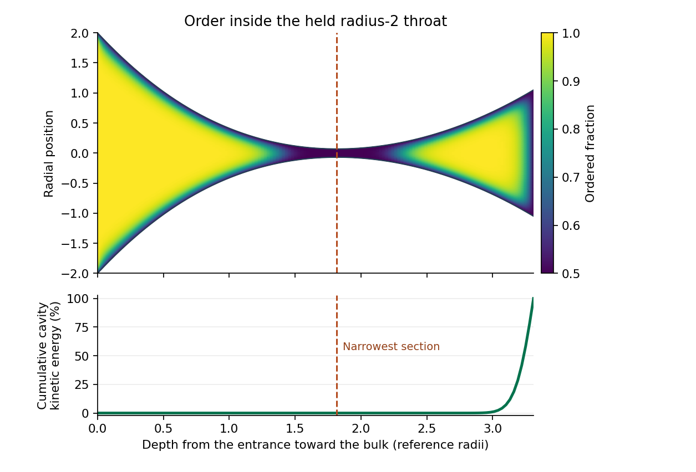

# Can the trapped wave brace a narrowing throat?

At both entrance radii the stored wave survived, mostly in the chamber downstream of the constriction. It pushed back against shortening and narrowing on the four regular profiles. The total force favored both narrowing and shortening on all six held shapes, including two where part of the material had reached zero order. Near a waist radius of 0.45, both entrances still had almost fully ordered cores and both felt a finite inward force. That shared width does not identify an equilibrium or an elementary throat radius.

## Held-shape measurements

The duct was sealed along its sides. The carrier flowed down the fourth spatial direction and exited into the receiving bulk at the terminal disk. The earlier sign change in carrier stiffness established a change in the total flow reaction when the sides were sealed. A Bernoulli contribution alone was not isolated. The two reservoirs maintained the same phase difference, 0.4510084282857874, for every shape. Thus the intake was a result of the geometry and material response. All preparations used the same absolute action \(J=1\) in the degree-four transverse mode. At each held shape we solved for the interior order, carrier density and phase, and the occupied wave with an open boundary into the feeding brane. The narrower radius-1 preparations used the physical bounds on the order fraction. On the receiving side we independently relaxed the neutral order field from the half-order dividing surface to the disordered bulk. The energy contains both halves of the front, the coherent carrier on both sides and the wave. Adding a separate surface-tension energy would count the front twice. [Field equations and controls](mouth_live_waist_fields.md) · [Interior order and time response](mouth_live_waist_order.md) · [Exterior order solver](../tools/mouth_waist_outer_order.py)

Write \(t=w/L\), with \(w\) the fourth spatial coordinate and \(L\) the mouth-to-exit depth. To widen the waist we displaced the profile by \(4t(1-t)q\), keeping both opening radii fixed. To lengthen the throat we varied \(\log L\) with its dimensionless radial profile held fixed. The table gives \(F_q=-\partial E/\partial q\) and \(F_L=-\partial E/\partial L\). Negative signs mean that releasing the corresponding constraint favors narrowing or shortening. Each row contains separate positive and negative steps at two sizes. Finite differences use actual length changes for axial forces. The waist coordinate is a distributed deformation, so its generalized force has a different meaning from a point traction.

| Entrance radius | Waist radius | Depth | Center order | Inward current | Radial force | Axial force |
|---:|---:|---:|---:|---:|---:|---:|
| 1 | 0.4444 | 1.8742 | 0.9996618 | 0.130313 | -10.5590 | -3.5441 |
| 1 | 0.2052 | 1.6656 | 0.5177808 | 0.025210 | -4.2109 | -1.1133 |
| 1 | 0.0870 | 1.5753 | 0.5003962 | 0.003681 | -1.7457 | -0.3272 |
| 2 | 0.4510 | 3.5326 | 0.9996982 | 0.115613 | -26.9984 | -7.0092 |
| 2 | 0.1751 | 3.3698 | 0.7221205 | 0.013140 | -15.2805 | -3.7509 |
| 2 | 0.0688 | 3.3099 | 0.5000013 | 0.001479 | -10.7472 | -2.8403 |

The signs persist on the tighter and wider sides of every listed waist, on the shorter and longer sides of every depth, and on both tested mesh combinations. The weakest shortening force was at the tight radius-1 waist. It changed from −0.4239 to −0.3272 on refinement. At that point the *inside* alone favored opening and lengthening. Including the independently computed order stress on the outside reversed both signs. A further exterior refinement at radius 1 broad and radius 2 tight changed their axial forces from −3.5441 to −3.5164 and from −2.8403 to −2.8158, respectively. A force zero between the six sampled profiles is still possible. One coarse radius-1 comparison uses the verified child output after loss of its final guard receipt. All six fine-grid cases have normal verified guard exits. [Signed energies, refinement and component forces](../../../research/pde_ledger_v3/_measurements/mouth_coupled_waist_balance.json) · [Reduction](../tools/mouth_waist_balance.py)

The two narrower radius-1 states required treating the crystalline fraction on its declared interval, including finite regions where it reached zero. Both shear coefficients vanish there. The calculation removed only wave degrees with zero mass and zero stiffness. The occupied wave survived elsewhere. These are constrained stationary candidates. Individually reopening a zero-order node gave no resolved negative energy slope on either mesh, and a separate finite-amplitude test reopening spatial halves also raised the energy. These checks sample accessible perturbations of the empty patch. Dynamics at the bounds and long-time stability remain open. Coarse-grid time controls at the tight and intermediate radius-1 waists gave center order ranges of 0.48222–0.51847 and 0.46936–0.56596 over two wave periods, respectively, with initially saturated sites held on the boundary by the chosen order displacement. On the intermediate radius-1 shape the wave-free flow profile had center order 0.89783. With the wave present the bounded branch gave 0.51778. Measuring the initial fixed-action shape work *before* the order readjusted also gave narrowing and shortening at both narrower radius-1 waists. [Order-field evidence](mouth_live_waist_order.md)

## What the wave and order did

In the broad radius-1 state, 99.99995283% of the computed cavity wave kinetic energy lay more than two interface widths downstream of the waist. In the tight radius-2 state the same downstream concentration persisted while center order reached 0.50000133. Under this constitutive law both the transverse stiffness and its inertia are proportional to order. A value of one half therefore retains half of each. The pressure exerted by the wave enters the force through its change in frequency under deformation. A well-confined wave can do some work on the walls while leaving too little restoring force at the waist. The registered wave cavity ends at the half-order dividing surface. Its computed leakage is into the feeding brane. The receiving-side half of the diffuse interface contributes neutral order energy here. An extension allowing that region to carry transverse wave stress would change the tested model. [Measured wave localization](mouth_live_waist_fields.md)

We also evolved the order and wave through two wave periods with the geometry held and the preparatory carrier density and phase frozen. This independent time check uses one localized order displacement and one wave mode with both choices of initial wave phase. The tight radius-2 center ranged from 0.49455870 to 0.50544149. This resolves a small oscillation around partial order. It cannot supply a time to pinch off or predict the subsequent motion of a freely moving flare. A separate homogeneous test exposes an additional limitation of the smooth scalar dynamics. From fully ordered material a sufficiently small, purely kinetic shear excitation initially accelerates the order above one. A constrained stationary minimization can enforce the physical interval. Evolution at its endpoints needs a material prescription. [Time test](mouth_live_waist_order.md) · [Saturated-material control](../tools/mouth_waist_order_range.py)

## Implication for 0PN gravity

A self-supporting physical mouth must resist both deformations and also balance the other free wall motions. These measurements find no such mouth on the tested degree-four preparation. They leave open other equilibria, wave occupations and microscopic laws. The earlier exterior inverse-square momentum supply still stands. Assigning the measured inertia of a held, externally supported throat to a free one would also assign it the fixture's unknown reaction. Radius 3 remains blind, and a universal free-fall ratio has yet to be measured on a self-supported family.

The next material discriminator is a wave-off crystalline lip with strain resolved through its thickness. Under equal positive and negative curvatures, measure its bending moment, subtract the neutral order-layer response, and use the resulting moment–curvature law to predict a second curvature before putting it into either throat. If there is no positive bending rigidity, a separately conserved winding would need its own preparation and an independent measurement of its pressure on a shrinking core. No rigidity, winding or radius-dependent action was fitted here.

**Independent review.** “Scoped clear for the inward radial and shortening axial forces on all six tested held profiles at two entrance radii. Independently computed interior work and the measured exterior order load reproduce all force directions. On the tight radius-one profile the exterior load reverses both interior signs. No tested profile is in force balance, and the calculations leave other shapes and a freely evolving throat open.” [Independent calculation on the four smooth profiles](../../../research/pde_ledger_v3/_measurements/mouth_live_waist_independent.json) · [Bounded profiles and six-row review](../../../research/pde_ledger_v3/_measurements/mouth_live_waist_independent_bounded.json)
