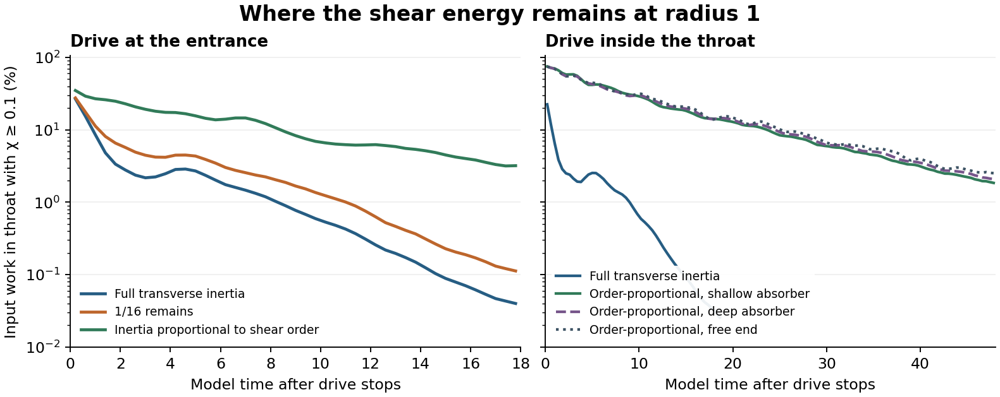

# Can shear loss trap enough wave energy to support a draining mouth?

**The loss of shear order can reflect a wave back into the throat. The opening still gives it a route onto the feeding brane.** I tested both paths using the brane’s transverse displacement field on one curved, held-open throat at a time. Its torsional motion has two resolved coordinates, radius and depth along \(w\), with the other two angles integrated exactly. The kinetic law determines how much energy stays near the throat. [Wave equation and geometry](mouth_order_wave_escape.md) · [Verified measurements and reviews](../../../research/pde_ledger_v3/_measurements/mouth_native_shear_ringdown.json)

**Drive and release.** A weak torque on the brane material leaves the mouth stationary. At radius 1 and inward rate 0.25, a short pulse excited an oscillation near angular frequency 12.2 at two locations. I then drove six cycles at 12.2, switched off the torque, and tracked the injected work. Moving the drive from the entrance to the ordered material deeper in the throat kept both probes in place. The carrier and shear-order profile stayed fixed throughout each test. [Burst calculation](../tools/mouth_shear_ringdown_burst.py)

| Radius-one result after driving inside the throat | Work in throat with appreciable shear (χ ≥ 0.1) | Work in weak-shear throat | Net work returned to feeding brane |
|---|---:|---:|---:|
| Constant transverse inertia, times 14–18 | 0.068% | 80.30% | 19.63% |
| Inertia proportional to shear order, times 14–18 | 16.40–18.13% | 0.89–3.21% | 76.53–78.66% |
| Inertia proportional to shear order, times 44–48 | 2.07–2.69% | 0.10–0.70% | 91.37–96.61% |

Times start at switch-off. Entries are time-averaged fractions of the work delivered in each run. The ranges cover three downstream terminations or cut positions. In the absorbing cases the remaining work crossed the specified interior cut; its fate in the receiving bulk is unknown. With constant transverse inertia the simulated receiver recorded zero energy over the reported window. Slow transit through the weak layer accounts for that observation. For the order-proportional law, moving the drive deeper raised the retained fraction from 3.85% to 16.40% at the same absorbing cut; refining the deeper run gave 16.34%. The long runs used the coarser of those two wave meshes. [Source-location comparison](../tools/mouth_shear_cavity_readout.py)

**What makes reflection possible.** On a separate plane shear ray through the measured radius-one layer, the ordered fraction fell with an e-folding length near 0.040. Continuing that decay into the bulk gives a cutoff \(\omega_c=1/(2\ell)\) when transverse inertia falls in proportion to order (fully ordered wave speed one). At 12.2, below the estimated cutoff of 12.52, this ray reflects all incident power. With full transverse inertia it reflects 0.17%; leaving one-sixteenth of the inertia in disordered material gives 10.94%. Radii 0.5 and 2 gave the same qualitative separation. Those carriers selected different intakes under the common reservoir bias, and the shear-loss layer also moved. A reflection measurement tests a material property; the whole-mouth releases separately measure escape onto the brane. [Ray and continuation](../tools/mouth_shear_tail_impedance.py)

**What this gives 0PN.** A damped oscillation near 12.2 appears in the material calculation. Its fitted lifetime depends on the observation window, and the inferred late axial force changes substantially under mesh refinement once wave momentum is included. The present equations permit an undriven, empty transverse field at the same intake. A free-fall prediction needs an independently selected stored action and its force on the mouth. The next discrimination is whether a particular interior wave pattern couples weakly to the outgoing brane waves, or whether maintaining its energy requires power from the drain. Relative transverse inertia through conversion can be tested separately by measuring local shear-wave speed at a known value of χ. [Material kinetic input](../../../docs/moving_interface_conversion_work_proposal.md#L93) · [Previous force requirement](mouth_wave_flare_work.md)

Working base `49dca23e`. Two local reviewers independently checked the calculations within the scopes recorded in the measurements. Formal project review and commit remain pending.
