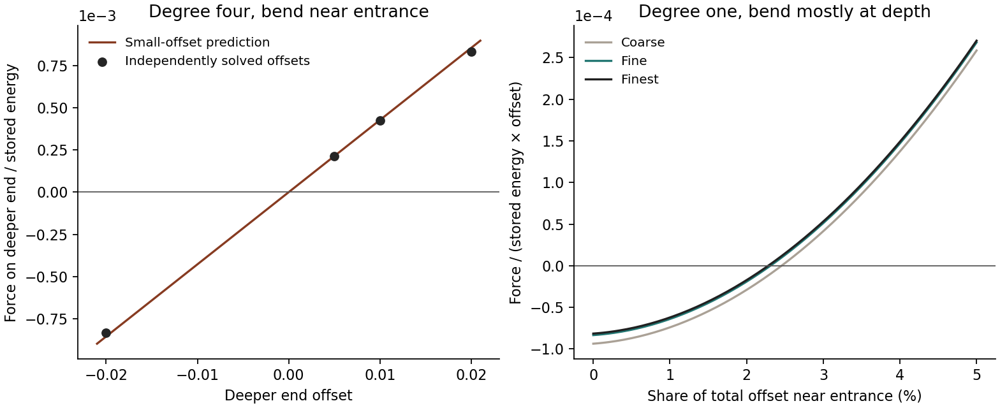

# Does the standing wave keep the entrance and flare aligned?

**The longest-lived tested wave pushes an offset farther apart.** A simpler wave restores alignment over a narrow range of imposed bends. Neither wave stabilizes both parts when the bend can redistribute freely.

The held mouth has radius 1 and inward intake 0.25. Spherical sections translate sideways through depth \(w\), carrying their order profile with them. Shear stiffness and transverse inertia both follow that order. The wave twists about the direction of the offset. For a small deeper-end displacement \(\Delta\), the modeled wave shape force is \(F/E=-k\Delta\), where \(E\) is stored wave energy. Positive \(k\) restores alignment. [Straight-mouth preparation](mouth_shear_pattern_release.md) · [Bend calculation](../tools/mouth_native_wave_bend.py)

| Wave pattern | \(k\), bend near entrance | \(k\), bend in deeper flare |
|---|---:|---:|
| Degree 1 | −0.1280756 | +0.0000815 |
| Degree 2 | −0.1315346 | −0.0001974 |
| Degree 3 | −0.0698456 | −0.0003823 |
| Degree 4 | −0.0424528 | −0.0005790 |

**Why the force reverses.** Holding the degree-four pattern fixed during a near-entrance bend gave \(k=+0.7480\) on the fine mesh. Letting the wave redistribute into its neighboring angular patterns gave \(k=-0.04250\). The table uses the finest mesh. In a separate drive-off test on the fine mesh, the entrance and flare reactions per unit energy and offset were −0.04255 and +0.04214 at times 32–54. These include changes in stored canonical wave momentum and exchange with the downstream cut. The physical recoil of bulk material remains open. [Direct stress and momentum readings](../tools/mouth_native_wave_bend_release.py)

**The degree-one exception.** This wave restored alignment only while the entrance region took less than 2.46%, 2.31% and 2.28% of a monotone offset on successively finer meshes. In a release with the entire bend at depth, opposite offsets of ±0.02 gave opposite restoring forces of magnitude 0.000001857 per stored energy at times 54–78. Halving the offset halved the force. Putting 5% near the entrance reversed the force along that prescribed path. Degrees two through four amplified every nonzero combination of the two tested bend shapes. [Two independent displacements](../tools/mouth_native_wave_bend_family.py) · [Finite-offset test](../tools/mouth_native_wave_bend_offset.py)

**What the material must supply.** Suppose the wall has independently measured area tension \(\sigma\) with the wave absent. The marginal \(\sigma/E\) for positive stiffness across both shapes is about **0.02126 for degree four** and **0.06415 for degree one**, in inverse wall-area units at radius 1. The ratio must exceed the marginal value. The next input is the baseline lateral stiffness of the unexcited draining mouth. The earlier axial calibration leaves it open. Absolute free-fall predictions also require the natural wave occupation and total moving inertia. [Tension requirement](../tools/mouth_native_wave_bend_requirements.py) · [Axial calibration](mouth_carrier_depth_selection.md)

Working base `49dca23e`. Two independent local reviewers checked the results within the recorded scopes. Formal project review and commit are pending. [Verified measurements and reviews](../../../research/pde_ledger_v3/_measurements/mouth_native_wave_bend.json)
