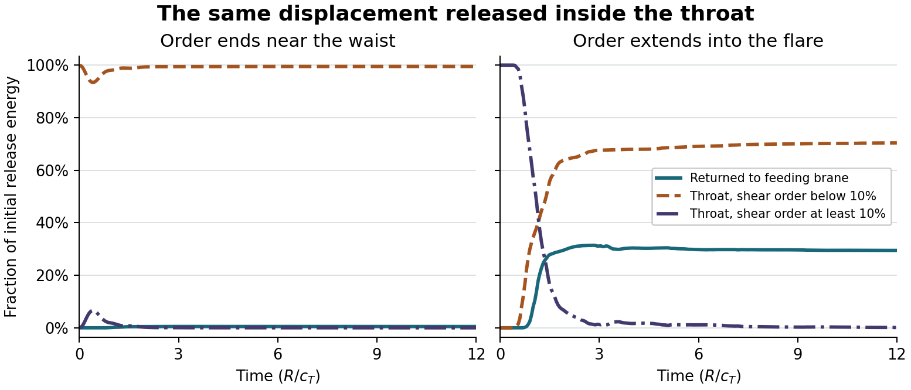

# Where a transverse wave goes in one flared throat

At fixed inward intake 0.25, extending shear order beyond the narrowest section makes the cavity much stiffer to the same small twist. The calculation also distinguishes a wave returning to the feeding brane from energy that takes a long time to travel through material as it loses shear. The result applies to one transverse polarization and two preparations of the same held-open throat.

**Geometry and material.** Follow the three brane coordinates and the depth coordinate $w$ through the rounded lip, waist and flare into the receiving chamber. Each filled cross-section normal to $w$ is a three-ball. Rotational symmetry permits exact angular integration for the chosen torsional displacement $\mathbf X=f(r,w,t)(\mathbf e_z\times\mathbf x)$. This excites shear in the material while the mouth stays still. The numerical mesh resolves radius and depth. Both previously calculated positions of the shear-loss layer are stationary on the prescribed carrier. Its response to the stress of the order layer remains open. [Preparation and order profiles](mouth_free_order_depth.md)

Take transverse stiffness $\mu_0\chi$ and constant transverse inertia $\rho_T$, with fully ordered speed $c_T=\sqrt{\mu_0/\rho_T}$. With the carrier and wall held fixed, evolve the variation of the quadratic wave action. After angular integration, the kinetic and strain energies are

$$
 T=\frac{4\pi}{3}\int\rho_T r^4\dot f^2\,dr\,dw,\qquad
 V=\frac{4\pi}{3}\int\mu_0\chi r^2\big[2 f^2+(2f+rf_r)^2+r^2 f_w^2\big]\,dr\,dw .
$$

The wall has zero applied tangential traction. The remote feeding boundary has a dissipative load matched to normally incident plane waves in ordered material. The receiving chamber starts at $w=3.05R$. Its distant face has zero shear order. The test counts net energy sent back across the opening as the energy currently in the feeding brane plus the energy absorbed at its remote edge. The local torsional stiffness vanishes continuously into the bulk.

**Two releases.** Release the same torsional displacement from rest in the collar between the waist and the start of the flare ($0.65<w/R<1.10$), or give the material the same transverse velocity kick near the entrance ($0.05<w/R<0.45$). Both disturbances are smooth, restricted to $r<0.48R$, and have amplitude $10^{-4}$ in code units. The two states receive identical energy in the velocity test. The work needed to impose the common cavity displacement measures how strongly it excites each state.

On the finer mesh of the earlier flare, the initial energy of the same cavity displacement is **335.0 times as large** in the deep state as in the near state. Each percentage below uses its own release energy. Time is measured in mouth radii divided by the fully ordered wave speed.

| Release | End of shear order | Back across the mouth | In throat, $\chi<0.1$ | In throat, $\chi\geq0.1$ | In receiving chamber |
|---|---|---:|---:|---:|---:|
| Cavity displacement | Near | 0.50% | 99.50% | <0.01% | 0% |
| Cavity displacement | Deep | 29.48% | 70.40% | 0.12% | 0% |
| Entrance kick | Near | 55.21% | 44.74% | 0.05% | 0% |
| Entrance kick | Deep | 59.24% | 40.54% | 0.23% | 0% |

The table gives the last sample at approximately $12R/c_T$. The near cavity release starts with 99.95% of its energy already in the weak material. The deep release starts in ordered material and transfers most of its energy into that layer. The displacement at the release probe first changes sign by the sample at 0.15 time units for the deep preparation and 2.45 for the near one. Both show local motion. This single release gives no frequency-resolved lifetime. For the delayed flare, 29.82% returns to the feed after the deep cavity release. Across the two refined meshes, all eight net feed fractions differ by less than 0.19 percentage points. The largest sampled relative error in the discrete energy balance was 5.1e-14. The balance uses the centered leapfrog energy, including boundary work.

**Limits and the next measurement.** In this propagation law the local wave speed falls as $\sqrt\chi$. A bound on the entire cross-section of the weak-order throat gives a minimum travel time of $419.266\,R/c_T$ even in the fastest of the tested geometries and states. Zero arrival in the receiving chamber by $12\,R/c_T$ is therefore expected. The calculation leaves open loss into other bulk excitations and the late-time fate of the slow shear signal. Aperture size alone also gives no sharp cutoff for the depth-uniform outgoing torsional channel in the feeding slab. Its radiation resistance in plane-wave units is $(kr)^2/[1+(kr)^2]$. Coupling strength and frequency matter. [Radiation and flow check](../tools/mouth_wave_flow_check.py)

An independent axial calculation tests the unknown kinetic law. It uses the same order profiles, a matched feed and a stress-free downstream cut at $w=2R$. At about $16R/c_T$ the earlier-flare near/deep runs return 53.0%/55.5% of their energy to the feed with constant inertia. When transverse inertia falls in proportion to order, the corresponding readings are 99.6%/99.9%. This comparison uses a single cross-section-averaged displacement and a different outlet from the full torsional calculation. Separately, advection could matter. At the entrance kick, the energy-weighted carrier speed is about 0.284 of the local shear speed. A trial that allows flowing material to carry transverse momentum had unresolved late energy balance on its finest mesh. It gives no reliable fraction exported to the bulk. [Inertia comparison](../tools/mouth_free_order_wave_inertia.py) · [Material transport control](../tools/mouth_wave_material_transport.py)

The decisive input for the next resonance calculation is the wave speed relative to the moving material as shear order falls. Oppositely directed weak ripples through the same small patch can separate wave speed from their common drift. For example, at one-quarter shear order, constant inertia predicts half the ordered-material speed. Inertia proportional to order predicts the full ordered-material speed. A ripple measurement on independently resolved material, or a derivation from identified moving constituents, would distinguish those predictions. Replaying either imposed inertia law would reproduce its assumed speed. With that input, drive the ordered collar over frequency, then turn the drive off and measure repeated oscillations, the decay time and the energy leaving each side. A reproducible long-lived mode could then be tested for pressure on the wall and momentum carried with the mouth. The free-fall acceleration at 0PN still requires the resulting **net** force and inertia. [Wave calculation](../tools/mouth_order_wave_pulse.py) · [Open kinetic normalization](../../../docs/moving_interface_conversion_work_proposal.md#L93) · [Measurements](../../../research/pde_ledger_v3/_measurements/mouth_order_wave_escape.json)

Working result on base `49dca23e`, uncommitted. The independent local reviewer concluded, “Scoped clear for the rest-frame, single-polarization finite-time energy accounting and the separate axial inertia comparison. The results distinguish the preparations and do not establish a standing mode, bulk conversion efficiency, or 0PN force.” Formal project review remains pending.
