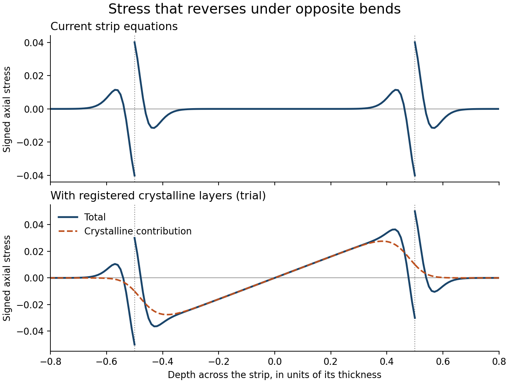

# Can an ordered strip carry the lip’s bending moment?

**The current strip equations give a negative bending stiffness.** Their axial stress changes mainly at the two order–disorder interfaces. If the crystalline layers stay registered, the added crystalline stress extends through the ordered interior. It is compressive on the inside of the bend and tensile on the outside. Both interfaces also carry pre-existing tension. A trial law with this property predicted the moment at a second curvature to **0.00634%**. Its modulus was an input to the trial. The supersolid’s physical modulus remains to be determined. [Stress profiles and signed measurements](../../../research/pde_ledger_v3/_measurements/mouth_ordered_strip_bend.json)

## Which strain is in the equations?

The coherent carrier supplies mass flow and pressure. The independent scalar field \(\chi\) describes crystalline order. The written material action also has a displacement \(u_d\), with shear energy proportional to \(\chi|\mathrm{curl}_4 u_d|^2\). Stretching an ordered layer uniformly along its length produces a symmetric strain with zero curl. A specified tangential attachment can load the curl field in a static bend. In this strip preparation only the half-order faces are registered, there is no imposed tangential attachment, and the wave is off. The active strip energy therefore lacks a term for stretching one material layer relative to another through the thickness. The earlier in-plane Cauchy elasticity study wrote such symmetric-strain invariants as candidates and left their moduli open. Its three-dimensional brane modulus and the carrier compressibility cannot supply a depth-resolved static modulus for this strip. [Written material action, P5–P7](../../../research/pde_ledger_v2/notes/stages/ledger_stage006_two_phase_chiB_ontology.md) · [Static attachment control](mouth_bend_static_shear.md) · [Constitutive audit](pathA_23_stage2_constitutive_form.md)

## Opposite bends and the second-curvature prediction

We bent the neutral, wave-empty strip cylindrically in one of its three tangential directions. Both superfluid baths were at equal pressure and uniform phase. Strip thickness was \(H=1\), order-interface width \(\delta=0.04\), and single-face tension \(\sigma=1\) in model units. The mid-surface area, both half-order heights \(s=\pm H/2\), and the other two curvatures were fixed. Both faces and the exterior order tails contributed. The flat strip already carried end tension \(2\sigma\) to the precision shown. We report the applied holding moment per unit transverse two-area, \(m=\partial(E/A_3)/\partial k\). A positive slope means the strip resists bending. [Calculation](../tools/mouth_ordered_strip_bend.py) · [Earlier neutral-strip calibration](mouth_lip_order_moment.md)

| Strip law | Holding moment at \(kH=-0.08\) | Holding moment at \(+0.08\) | Predicted at \(+0.04\) | Measured at \(+0.04\) | Relative error |
|---|---:|---:|---:|---:|---:|
| Current scalar order, wave off | +0.000214033 | −0.000214033 | −0.000107017 | −0.000106754 | 0.246% |
| Registered crystal trial, \(Y_*H/\sigma=1\) | −0.005240306 | +0.005240306 | +0.002620153 | +0.002620319 | 0.00634% |

The full-strength signed pair set the slope and intercept before the half-strength solves. Reversing the half-strength bend gave the opposite moment with the same precision. The depth-integrated stress also agreed with the derivative of independently re-relaxed energies to within \(5.1\times10^{-11}\) on both numerical grids. In the training pair, the part of axial stress reversing under the bend at \(s/H=+0.25\) was \(+0.00001281\) in the current strip and \(+0.01993571\) in the trial. At \(-0.25\) both signs reversed. The dotted lines below mark the two pinned half-order surfaces. Separate curves on either side retain their one-sided stresses. [Profile and moment readout](../tools/mouth_ordered_strip_readout.py)

## What the calibration would require of the material

For the trial only, layers keep a common flat reference and remain locked through the thickness. Their axial strain in pure bending is \(\epsilon=ks\). We added \(Y_*\chi^2\epsilon^2/2\) per unit reference four-volume, with the same coefficient in every flat and bent specimen. The \(\chi^2\) dependence is a constitutive hypothesis. \(Y_*\) is an effective slow axial modulus under this preparation’s transverse constraints. The calculation re-relaxes \(\chi\) on every bend. With \(e_\chi=a_B[\chi^2(1-\chi)^2+\delta^2(\partial_s\chi)^2]\), the energy and measured holding moment are
\[
\frac{E}{A_3}=\int\!\left[(1+ks)e_\chi+\tfrac12Y_*\chi^2(ks)^2\right]ds,
\qquad m=\int\!s\,[e_\chi+Y_*\chi^2 ks]\,ds .
\]
There is no separate added surface tension. In the flat limit the independently predicted extra stiffness is \(Y_*\int s^2\chi_0^2ds\). The measured integral is \(0.06817602\,H^3\), and the neutral strip has \(D_\chi=-0.00266667\,\sigma H^2\). Thus the trial changes the sign of the small-curvature stiffness at **\(Y_*H/\sigma=0.03911444\)**. At the chosen benchmark value of one, the total stiffness is \(+0.06550935\,\sigma H^2\). A separate uniform ±0.001 extension gave an incremental end tension per unit strain of \(0.920000\,\sigma\) in the trial and zero in the neutral law. This checks how to read out the modulus within the trial. An independent physical input would be the sustained axial stress at several depths of a flat, ordered specimen while both faces are free of tangential tractions, with layer registration and lateral constraints measured. If the layers slide and lose stress during the hold, the instantaneous stretch modulus overstates the slow bending response.

**Gate for a throat calculation.** At the threshold the linear stiffness vanishes. Above it, this flat strip resists weak cylindrical bending. Supporting the throat requires force balance in both width and depth. The calibration reached \(|k|H/2=0.04\). At a waist of radius 0.45, the hoop curvature alone would give \(|k|H/2\simeq1.1\) for a wall carrying that entire thickness. Parallel surfaces would reach the axis before traversing the full half-thickness. Identify the actual load-bearing thickness or resolve the crystal directly on that geometry, and establish its response to simultaneous axial and hoop strains. A throat calculation must retain the receiving-side and interior stresses, count each interface once, and solve the occupied wave on the new shape. In the previous calculation the occupied wave concentrated downstream of the waist. The single cylindrical bending measurement supplies no universal stiffness for these other deformations. Radius 3 stays reserved. [Two-sided waist forces and wave location](mouth_coupled_waist_balance.md)

**Independent review.** “Scoped clear for the signed bending moments of the two registered half-order faces under fixed mid-surface area and separation, the reserved-curvature predictions, and the threshold separating the two incremental stiffness signs for the assumed squared-order axial modulus. The physical modulus, mixed-curvature law, rim reaction and free-mouth force remain open.” The reviewer solved the flat order sensitivity separately and differenced the energies of independently minimized finite-element strips. [Guarded independent calculations and verdict](../../../research/pde_ledger_v3/_measurements/mouth_ordered_strip_independent.json)
