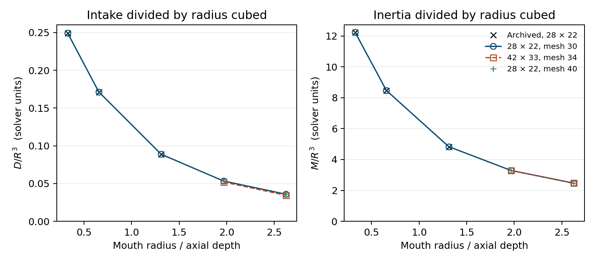

# How the fixed-depth radius family loses universal free fall

The 9.88% radius-4 deficit comes from **intake per unit inertia**. On the archived solutions, increasing radius from 1 to 4 multiplies intake per radius cubed by 0.35578844 and inertia per radius cubed by 0.39486463. The fraction of intake appearing in the held-stream force, $C/D$, changes by a factor of 1.00014596. Their product and quotient give $0.35578844\times1.00014596/0.39486463=0.90117054$ for the acceleration response $C/M$ relative to radius 1. Absolute inertia rises with radius. Dividing by $R^3$ exposes why the increase falls short of cubic scaling. The archived force already used interior momentum and stress integrals.

We predicted a further decrease in $C/M$ at the unseen radii 6 and 8 and $C/D$ within 1% of unity. Both predictions held. All five mouths have the same material, slab thickness 1, prescribed cubic flare family and far phase difference 0.4510084282857874. Total axial depth from slab face to exit is $L=3.05$ in solver units. Intake $D$ is an output, checked against the derivative of stationary energy. $C$ is the brane-stream force on the held mouth per incident velocity. $M$ is the carrier inertia from the accelerating solution and stored momentum. The radius parameter scales the transverse dimensions of the entire chart. Each wall remains rigid throughout this comparison.

| Radius | $R/L$ | $D/R^3$ | $M/R^3$ | $C/D$ | $C/M$ |
|---:|---:|---:|---:|---:|---:|
| 1 | 0.328 | 0.249618 | 12.23588 | 0.999298 | 0.0203862 |
| 2 | 0.656 | 0.171440 | 8.47448 | 0.999910 | 0.0202283 |
| 4 | 1.311 | 0.088808 | 4.83301 | 1.000218 | 0.0183793 |
| 6 | 1.967 | 0.053345 | 3.28799 | 1.000739 | 0.0162361 |
| 8 | 2.623 | 0.035804 | 2.46640 | 1.002046 | 0.0145464 |

The table uses a common mesh parameter 30, reservoir radius 28 and roof height 22. Two interior force windows stay inside those reservoirs at every radius. At radii 6 and 8 the largest change in $C/M$ on switching windows was 0.008%. Refining to mesh 40 gave 0.0162294 and 0.0145403. Increasing the box to 42 by 33 and using mesh 34 gave 0.0158077 and 0.0138839. The radius trend survives both controls. The shift with box size reaches about 4.6%, so these values are finite-box measurements. All three original wider-box dipole runs exceeded the existing absolute residual gate of $3\times10^{-8}$. Refinement with higher-precision residual accumulation passed the same gate at radii 6 and 8. Radius 4 again exceeded the gate. Its wider-box force remains unresolved.

There is a way to see which region matters. For phase $\theta$ and stationary density $n$, the local integrals of $n|\nabla\theta|^2/D^2$ sum to the phase difference divided by intake. This measures the phase gradient needed to sustain a conservative current. The share in the feeding slab and rounded lip rises from 47.25% to 73.64% between radii 1 and 8. The corresponding receiver share increases from 2.62% to 5.91%. An independent zero-intake translation calculation partitions kinetic inertia by region. The conduit contribution to $M_0/R^3$ falls from 10.408 to 0.8184. The receiver contribution goes from 1.607 at radius 1 through 2.263 at radius 2 to 1.571 at radius 8. Thus access to the feed matters increasingly, while the proposed monotonic rise in total $M/R^3$ from a dominant four-dimensional bulk term fails on this family. These regional inertia measurements are at zero intake. The finite-intake total is measured separately in the table.

**Implication for 0PN.** The rigid carrier nearly meets the unequal-mouth force reciprocity condition on this range. It misses universal acceleration per incident flow, by about 29% at radius 8 relative to radius 1 in the primary box. This supplies a quantitative target for a self-supporting family of mouths. Predict its depth, shape and intake from the same material law and repeat the unequal-radius test without tuning per mouth. The sealed side and open exit remain explicit assumptions of this calculation. The test supplies no independent selection of the physical shape, choking or elementary radii.

[Measurement manifest, predeclaration and controls](../../../research/pde_ledger_v3/_measurements/mouth_radius_pivot.json) · [Archived radius measurements](../../../research/pde_ledger_v3/_measurements/mouth_carrier_0pn.json)

Independent review: “Scoped clear for the finite-box tow decomposition and fixed-depth unequal-radius scaling, including the radius-4 attribution and the radius-6 and radius-8 controls.” The reviewer checked the force archive, both larger-bath controls, the four excluded histories, the regional sums and the figure against the manifests.
