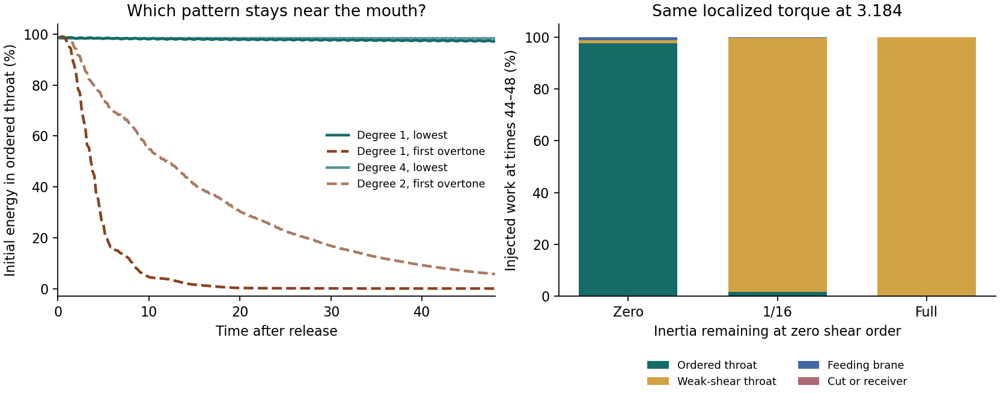

# Which standing waves survive in one draining mouth?

**One and the same throat can lose almost its entire excitation through the opening or keep an identifiable wave for 200 model time units.** The result depends on the shape of the wave and how much transverse inertia the material retains as it loses shear order. The mouth was held at radius 1, depth scale 1 and inward intake 0.25. All drives acted on the brane material. The carrier, geometry and conversion profile stayed fixed. [Verified measurements and review scopes](../../../research/pde_ledger_v3/_measurements/mouth_shear_pattern_release.json) · [Earlier six-cycle test](mouth_native_shear_ringdown.md)

**Release through the opening.** With transverse stiffness and inertia both proportional to the ordered fraction χ, prepare a standing torsional velocity pattern behind the waist and release the waist constraint. The full feeding slab is then open to the wave. For a toroidal vector harmonic of degree ℓ, angular integration, with the same angular normalization, replaces the earlier ℓ = 1 strain term \(2 f^2\) by \(\ell(\ell+1) f^2\). Each preparation has the same initial energy. “Lowest” and “overtone” refer to closed preparation frequencies within each angular degree. The net feed reading adds energy present on the feeding brane to energy already absorbed at its remote edge. [Release calculation](../tools/mouth_shear_pattern_release.py)

| Pattern | Preparation angular frequency | Initial energy in ordered throat at times 44–48 | Initial energy transferred to feed by times 44–48 |
|---|---:|---:|---:|
| Degree 1, lowest | 3.1841 | 97.358% | 1.503% |
| Degree 1, first overtone | 6.2414 | 0.0457% | 99.878% |
| Degree 2, lowest | 4.2728 | 98.545% | 0.1047% |
| Degree 2, first overtone | 7.3531 | 6.406% | 93.485% |
| Degree 3, lowest | 5.3634 | 98.493% | 0.00945% |
| Degree 4, lowest | 6.4462 | 98.363% | 0.00135% |

Entries are time-window averages. “Ordered throat” counts material at positive depth with χ ≥ 0.1. The other energy lies in the weak-shear throat or has crossed the specified interior cut. The degree-one overtone and the degree-four lowest mode have similar frequencies and very different leakage. Their frequencies differ by 0.205 in model units, so this comparison does not isolate angular degree at exactly equal frequency. A finer wave mesh gave 97.358%, 0.0449% and 98.373% retained for the first, second and last rows, respectively.

**Can a localized drive excite it?** Six cycles of torque at 3.184, applied at depth 0.88, left 97.70% of the delivered work in the ordered throat at times 44–48 after switch-off on the fine grid. The same spatial drive at 6.241 returned 99.999% of its work to the feed on the coarse grid. Two separate readouts gave a free ringing frequency near 3.1572 for the lower drive. A second torque, localized in radius and depth and given the degree-four angular pattern, produced a free oscillation at 6.44616. A sinusoid fitted over times 60–100 predicted the spatial projection and a separate patch deeper in the throat over times 170–198, with relative errors of 0.0263% and 0.224%. At times 194–198, 99.9962% of the window-averaged kinetic energy on the grid lay in the prepared spatial shape. [Local drive and spatial projection](../tools/mouth_shear_pattern_probe.py) · [Held-out predictions](../tools/mouth_shear_pattern_readout.py)

**How much power leaks?** At times 194–198, 94.08% of the original degree-one lowest-mode energy and 98.33–98.37% of the degree-four lowest-mode energy remained in ordered throat material. For degree four, net energy transfer to the feed between the 44–48 and 194–198 windows averaged \(1.16\text{–}1.34\times10^{-8}\) per unit initial energy and time across the three downstream conditions. Moving the dissipative cut from depth 1.8460 to 2.1397 reduced power crossing the cut from \(2.29\times10^{-6}\) to \(3.22\times10^{-9}\) on the same basis. A free cut transmits zero by construction. These are observed finite-interval rates. They leave the physical receiving-side loss and the asymptotic lifetime open.

**Which material property matters?** Keep the degree-one torque, drive frequency 3.184 and carrier preparation fixed. Write the transverse inertia as \(\rho_T=\epsilon+(1-\epsilon)\chi\) in fully ordered units. At times 44–48 the fine-grid ordered throat held 97.70% of the input work for zero residual inertia. With one-sixteenth left at zero order, it held 1.68% and the weak-shear throat held 98.08%. With full residual inertia, the weak-shear throat held 99.86%. The positive-inertia runs include the receiving chamber, which registered zero energy over this interval. With the common shallow cut, ordered retention for the one-sixteenth law was 1.69%. Moving the zero-inertia cut deeper or making it free gave 97.71%. At positive residual inertia, shared cut nodes carry half-cell inertia from the downstream mesh, so cut damper work only measures sensitivity to that numerical load. The one-sixteenth case rang at 3.089 and the zero-residual case at 3.157. Each percentage uses the work delivered to that preparation. The comparison tests one drive spectrum. Other resonances at positive residual inertia remain possible. An independent local ripple speed at measured \(\chi\) distinguishes the trial material laws via \(c_T^2/c_{T,1}^2=\chi/[\epsilon+(1-\epsilon)\chi]\).

**What this gives 0PN.** Under the order-proportional law, a wave prepared in this material can remain coherent on the timescale set by the inverse slow angular frequency \(1/0.005=200\). A full slow cycle takes \(400\pi\) time units. For an isolated symmetric throat a toroidal displacement is tangent to each angular sphere and divergence-free there. Its overlap with a scalar pressure gradient integrates to zero. The stationary inward flow in these equations supplies no linear torque; the externally delivered work sets the observed amplitude. The next gravity test is the *sideways restoring force per stored wave energy* when the entrance and deeper flare are displaced relative to one another, with both reactions accounted for. An absolute acceleration will also require an independently determined wave occupation and total moving inertia. [Earlier conditional force calculation using a different wave law](mouth_wave_flare_work.md)

Working base `49dca23e`. Independent local scientific reviews have the scopes quoted in the measurements. Formal project review and commit are pending.
